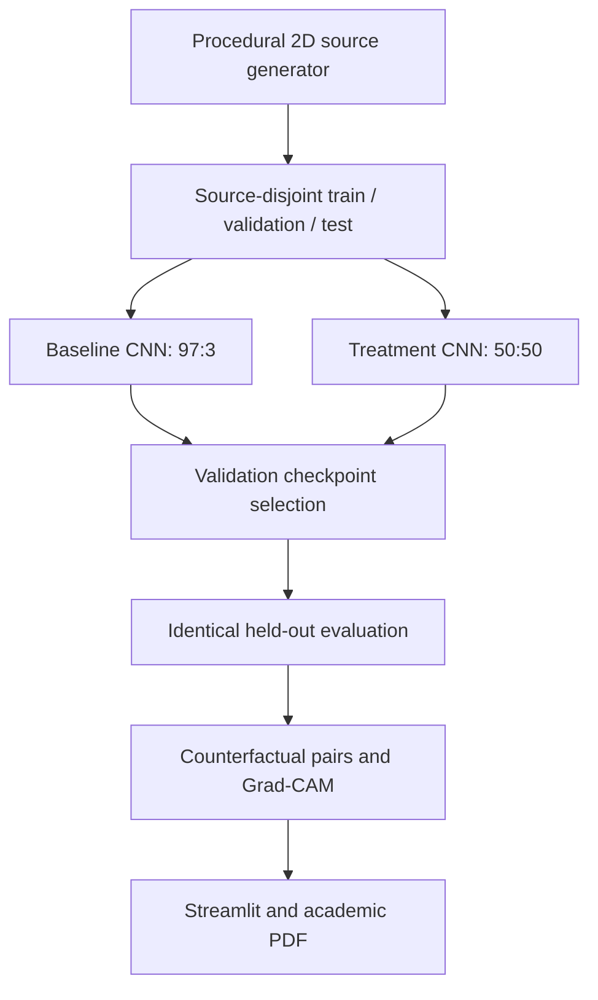
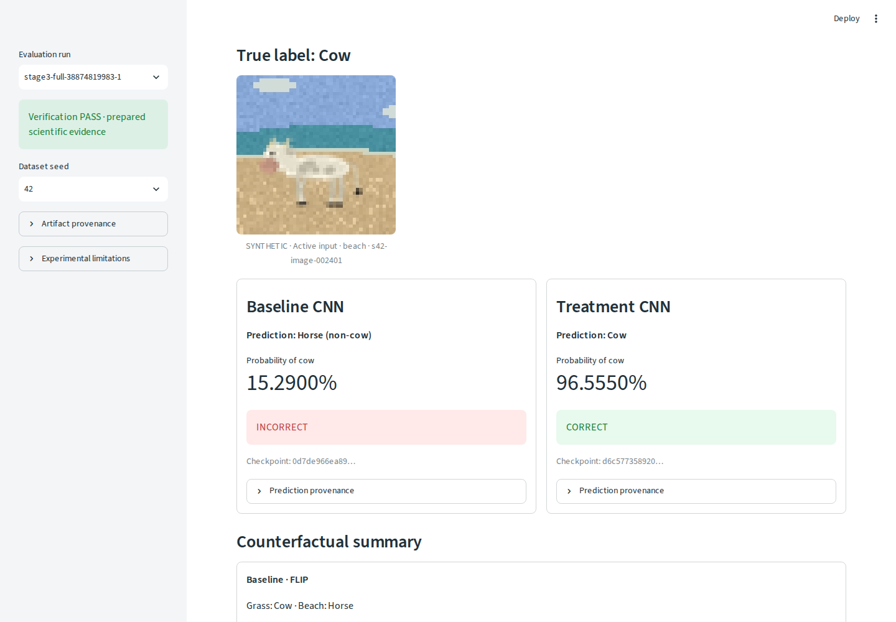

# CowBias Lab

A controlled synthetic experiment asking whether balancing training backgrounds reduces the
cow/grass shortcut and improves recognition of a cow on a beach. Two real CNNs are trained
from the same initial weights and evaluated on identical held-out images.

**Stages 1-4 are merged. Stage 5 provides the academic report, reproducible export, evidence
traceability and final acceptance; its PR requires independent review before merging.**

- [Academic report, Indonesian PDF](docs/task-3-report.pdf)
- [Reproducibility, archival status and QA](docs/reproducibility.md)
- [Five-minute presentation and lecturer questions](docs/dashboard-guide.md)
- [Scientific methodology](docs/methodology.md), [original results](docs/stage3-results.md)
- [Evidence manifest](docs/evidence-manifest.json), [PRD](docs/PRD.md), [PLAN](docs/PLAN.md)

## Assignment and research scope

Tugas 3, Artificial Intelligence, Magister Informatika, UIN Sunan Kalijaga, asks for a system
implementing treatment for fake correlation and a visualization explaining that treatment.
The provided example is a cow classifier that fails when grass changes to beach. The exact
instruction is quoted in the report. The original DOCX was not available in the Stage 5 workspace;
the supplied text and repository PRD were used. No lecturer rubric or deadline is invented.

Synthetic cow/horse renderers, CNN, three seeds, WGA, Grad-CAM, Streamlit and GitHub are **project
decisions**, not additional lecturer requirements. The assignment does not explicitly require
combining Deep Learning, LLM and Generative AI. This implementation uses Deep Learning.

## Implemented architecture



Source modules are `data/` (generation/audit), `models/` and `training/` (paired optimization),
`evaluation/` (frozen evaluation and independent verification), `dashboard/` (read-only UI),
`report_data.py`, `report.py`, `report_verification.py`, and `evidence.py` (Stage 5).

## Data and treatment

| Per seed | Cow/grass | Cow/beach | Horse/grass | Horse/beach | Total |
|---|---:|---:|---:|---:|---:|
| Baseline train | 485 | 15 | 15 | 485 | 1,000 |
| Treatment train | 250 | 250 | 250 | 250 | 1,000 |
| Shared validation | 60 | 60 | 60 | 60 | 240 |
| Shared test | 120 | 120 | 120 | 120 | 480 |

Each seed (42, 123, 2026) has 2,720 composites across the two training arms and shared evaluation
splits. Training arms reuse the same 1,000 foreground instances in the same order. Treatment
changes only the randomized background assignment, with exact 50:50 quotas per label; it is
**not fine-tuning** of a baseline checkpoint. Test has 240 genuine foreground pairs per seed.

Original foreground/background identities and families are assigned to splits before rendering.
The audit checks IDs, family/hash leakage, exact quotas, deterministic source and assignment replay,
all reconstructed composites, and paired masks/opaque foreground pixels. Soft-alpha edge pixels
can change with the background. Images are procedural RGB 48×48; model inputs are RGB 32×32.
No stock photographs or fabricated replacement images are used.

## Install and smoke pipeline

Python 3.11/3.12 are covered by routine CI; full acceptance uses Python 3.12. Use a clean venv.
For original source-pixel reproduction, use the recorded dependency versions:

```bash
python -m venv .venv
source .venv/bin/activate  # Windows: .venv\Scripts\Activate.ps1
python -m pip install torch==2.14.1 --index-url https://download.pytorch.org/whl/cpu
python -m pip install numpy==2.5.4 Pillow==12.3.0 PyYAML==6.0.3 matplotlib==3.10.8
python -m pip install -e '.[eval,ui,dev,report]'

python scripts/prepare_data.py --config config/experiment.yaml --seeds 42 --output artifacts/runs/data
python scripts/prepare_data.py --audit artifacts/runs/data/seed_42/data --config config/experiment.yaml
python scripts/run_experiment.py --config config/experiment.yaml --smoke --device cpu --output artifacts/runs/smoke
python scripts/verify_checkpoints.py --run artifacts/runs/smoke
python scripts/evaluate_experiment.py --training-run artifacts/runs/smoke \
  --data-run artifacts/runs/smoke/datasets --seeds 42 --smoke --output artifacts/runs/smoke-eval
python scripts/verify_evaluation.py --run artifacts/runs/smoke-eval
```

Smoke results are development evidence, never replacements for the original three-seed experiment.
For a future full replication, omit `--smoke` and use a **new** output directory; do not overwrite
original evidence. [Reproducibility instructions](docs/reproducibility.md) distinguish the original
full run, fresh smoke tests, and optional future replication. Every CLI implements `--help`.

## CNN and fair training

SmallCNN has three Conv2D/ReLU/MaxPool blocks (16/32/64 channels), adaptive 4×4 pooling,
Linear(1024,64), ReLU and Linear(64,1): **89,249 trainable parameters**. Training is from scratch,
AdamW (learning rate 0.001, weight decay 0.01), BCEWithLogitsLoss, batch size 64 and seven epochs.
Preprocessing is Pillow bilinear resize, CHW float32, `(pixel/255 - 0.5)/0.5`; no augmentation.

Paired arms share exact initial parameters, foreground batch permutations, budget, optimizer,
preprocessing and validation data. Each has a fresh optimizer. Selection uses highest validation
WGA, then highest validation overall accuracy, then earliest epoch. Verified selected epochs:

| Seed | Baseline | Treatment |
|---|---:|---:|
| 42 | 7 | 4 |
| 123 | 7 | 7 |
| 2026 | 1 | 4 |

This is validation-based checkpoint selection, **not Grid/Random/Bayesian/Optuna hyperparameter
search**. Test data is inaccessible to training. `docs/task-3-report.pdf` includes the actual six
training histories and selected epochs.

## Original scientific evidence and results

| Evidence | Workflow run | Artifact ID | Executed source |
|---|---|---|---|
| Six trained CNNs | [38827143763](https://github.com/alfrzhb/cowbias-lab/actions/runs/38827143763) | 12015781574 | `881be87ef2d83100b51bfb069e1fa75097eb9688` |
| Held-out evaluation | [38874819983](https://github.com/alfrzhb/cowbias-lab/actions/runs/38874819983) | 12035480745 | `f4c517e64c20ed3498a656ff31dcb67bdbc5e69d` |
| Browser review | [39140400975](https://github.com/alfrzhb/cowbias-lab/actions/runs/39140400975) | 12141178453 | `4fc877ae5350a0af9d70f6f6c9533e97276bd254` |

Evaluation run: `stage3-full-38874819983-1`. Both models see the same 480 test images per seed.
Prediction is cow when logit ≥ 0 / P(cow) ≥ 0.5. The evidence contains 2,880 predictions, 1,440
model-specific pair evaluations, and 2,880 genuine Grad-CAM maps.

| Metric, mean ± sample SD over 3 seeds (%) | Baseline | Treatment |
|---|---:|---:|
| Overall accuracy | 63.33 ± 19.24 | 99.51 ± 0.52 |
| Worst-group accuracy | 18.33 ± 25.54 | 98.61 ± 1.73 |
| Background flip rate | 73.33 ± 38.48 | 0.69 ± 0.64 |
| Paired correctness | 26.67 ± 38.48 | 99.17 ± 0.83 |

These documented values summarize the verified original `summary.json`; the report and dashboard
load their values from artifacts. Treatment corrects 522 baseline errors and introduces one new
error; seven treatment predictions remain wrong. [Per-seed results and limitations](docs/stage3-results.md)
retain the observed failures. Low flipping alone is insufficient: a model can be stable and wrong.

## Restore, verify, demonstrate and export

Use authorized `gh` access to Actions, or obtain the exact original ZIPs through authorized GitHub
access and run the archival script without `--download`. No credentials are committed or printed.

```bash
python scripts/archive_evidence.py --download --extract \
  --directory artifacts/evidence --manifest artifacts/archive-manifest.json
python scripts/verify_evaluation.py \
  --run artifacts/evidence/stage3-scientific-results/stage3-full-38874819983-1 --require-full
python scripts/prepare_dashboard.py --archive artifacts/evidence/stage3-scientific-results.zip
python scripts/verify_dashboard.py \
  --run artifacts/runs/downloaded-stage3/stage3-full-38874819983-1
COWBIAS_EVAL_ROOT=artifacts/runs/downloaded-stage3/stage3-full-38874819983-1 \
  streamlit run app/streamlit_app.py
```

The five tabs are Overview, Dataset Explorer, Model Comparison, Evaluation, and Explainability &
Export. Seed and background switching preserve exact image/foreground identity. Original CSV,
JSON and PNG downloads are byte-verified. Zero Grad-CAM remains zero with undefined attribution
shares. Missing evidence displays an informative empty state. No training or inference runs in UI.



[Actual mobile screenshot](docs/images/dashboard-mobile.png). The original review ZIP and new
acceptance evidence contain real three-viewport screenshots and export verification.

## Reproducible academic report

The tracked report is a deliverable. The exporter rejects existing output paths; to reproduce and
compare it, use **new** paths as below. It verifies original archive bytes, every extracted member,
six checkpoints and histories, source compatibility, evaluation arithmetic, image arrays and maps.

```bash
python scripts/export_report.py --run-id stage3-full-38874819983-1 \
  --stage4-root artifacts/evidence/stage4-dashboard-review \
  --output artifacts/report/task-3-report.pdf --manifest artifacts/report/evidence-manifest.json
python scripts/verify_report.py --pdf artifacts/report/task-3-report.pdf \
  --manifest artifacts/report/evidence-manifest.json --compare-manifest docs/evidence-manifest.json \
  --render-dir artifacts/report/pages
```

`--run` aliases `--run-id`. `--artifact-root`, `--training-run`, `--archive-dir`, `--output` and
`--manifest` are configurable. The optional `--stage4-root` adds the genuine screenshot; absence
omits it, never invents one. The manifest traces every table/figure, seed, input path and hash.
PDF checks match table cells and embedded figure pixels, validate links, text and page bounds.
Visual inspection of every rendered page remains an explicit review step.

## QA, preservation and limitations

```bash
python -m pytest -q -rs
python -m ruff check .
COWBIAS_TEST_EVIDENCE=artifacts/evidence \
COWBIAS_TEST_FULL_RUN=artifacts/runs/downloaded-stage3/stage3-full-38874819983-1 python -m pytest -q
```

Routine CI tests Python 3.11/3.12 with genuine small training/evaluation, without downloading full
archives. Tests requiring original archives are explicitly skipped there and run in the separate
[Stage 5 acceptance workflow](.github/workflows/final-acceptance.yml): exact source checkout,
isolated fresh-clone installation, authenticated pinned evidence recovery, all tests, dataset replay,
smoke pipeline, Chromium, PDF generation/content comparison/rendering and review-artifact upload.

**Durable archival: PENDING.** The repository is public; no authorized access-controlled durable
destination was available. Nothing was uploaded as public release assets. Original ZIP bytes,
checksums and member inventories are preserved locally and recovery is scripted, but Actions
retention (14/16 January 2027) and temporary workspaces are not permanent storage. See the exact
limitations and archive hashes in [reproducibility.md](docs/reproducibility.md).

Results are limited to procedural cow/horse images and grass/beach. Three seeds jointly vary data
and initialization; pair members share foreground. No confirmatory significance analysis or
real-photo generalization was tested. Generator/compositing artifacts, mixed Grad-CAM, zero maps,
residual errors and the new treatment error remain visible. No universal robustness claim is made.

## References and attribution

- Geirhos et al. (2020), [Shortcut learning in deep neural networks](https://doi.org/10.1038/s42256-020-00257-z).
- Xiao et al. (ICLR 2021; preprint 2020), [Noise or Signal: The Role of Image Backgrounds in Object Recognition](https://arxiv.org/abs/2006.09994).
- Sagawa et al. (ICLR 2020; preprint 2019), [Distributionally Robust Neural Networks for Group Shifts: On the Importance of Regularization for Worst-Case Generalization](https://arxiv.org/abs/1911.08731).
- Selvaraju et al. (ICCV 2017), [Grad-CAM: Visual Explanations from Deep Networks via Gradient-Based Localization](https://doi.org/10.1109/ICCV.2017.74).

There is currently **no repository LICENSE granting a general reuse license**. Dependency licenses
remain their own. Images are procedurally generated by this repository; original work and academic
references require attribution. The report leaves student identity unassigned. Individual
contributions and software/AI assistance must be accurately disclosed under course rules;
this repository does not establish that a particular student personally wrote or executed all code.
